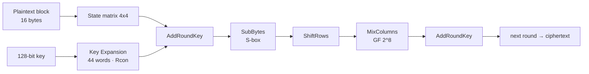

# CIFRA-AES — AES-128 from scratch (Python)

A step-by-step implementation of the **AES-128** block cipher written from scratch in
Python with NumPy — **no crypto libraries**. Every stage of the algorithm is built and
printed by hand: the S-box substitution, the key expansion, and the round transforms,
so you can actually *watch* the state matrix change after each step.

> Built as a deep dive into symmetric cryptography. Instead of calling `AES.encrypt()`,
> every byte-level operation is implemented and traced — the same low-level, systems
> mindset behind game-engine code.

## The AES round, visualized



## What's implemented

| Stage | Detail |
|-------|--------|
| **State matrix** | Plaintext and key parsed into a transposed 4×4 byte matrix |
| **Key Expansion** | Full schedule — 44 words, `RotWord`, `SubWord`, `Rcon` |
| **SubBytes** | Complete 256-entry AES S-box |
| **ShiftRows** | Cyclic left-shift per row |
| **MixColumns** | Multiplication in the Galois field GF(2⁸) (`galois_multiply`) |
| **AddRoundKey** | XOR of the state with the round key |

## Run it

```bash
pip install numpy
python aes.py
```

The script prints the state matrix after every transformation, round by round.

## Notes

- Educational, single-block **AES-128** — focused on exposing the internals, not for
  production use.
- Part of a cryptography study set — see also
  [secure_chat](https://github.com/PedroDelgadoHenriques1/secure_chat) (Diffie-Hellman key
  exchange) and [chat-tcp](https://github.com/PedroDelgadoHenriques1/chat-tcp)
  (DES, RC4, Caesar and Vigenère over TCP).
